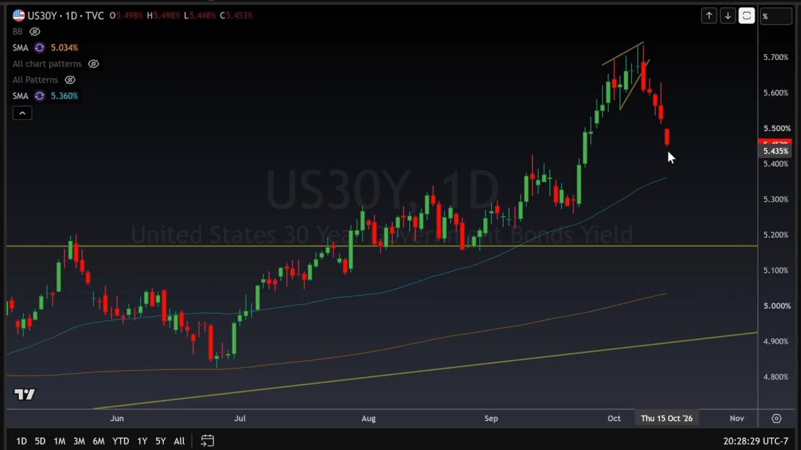
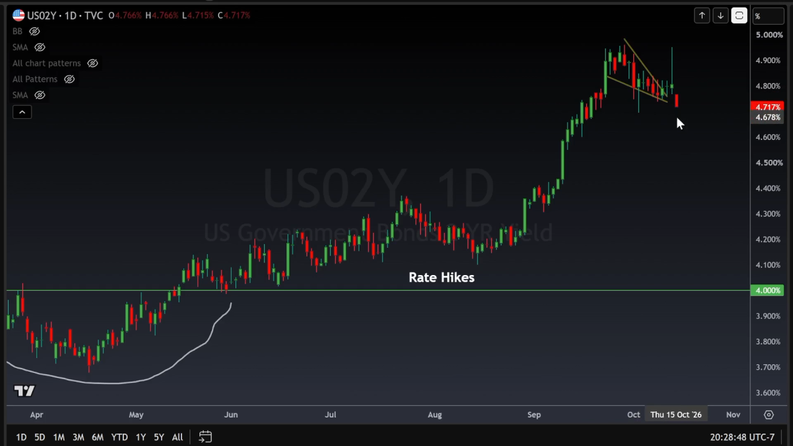
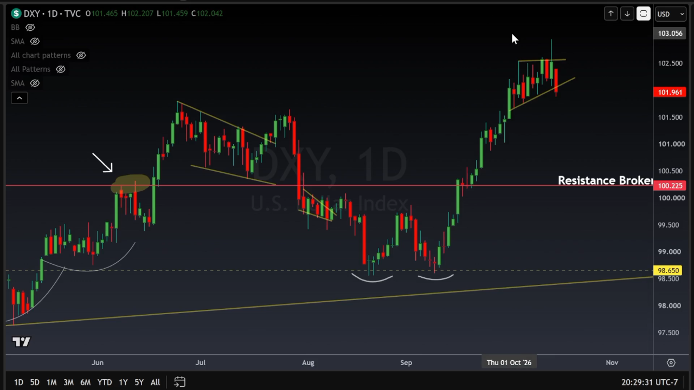
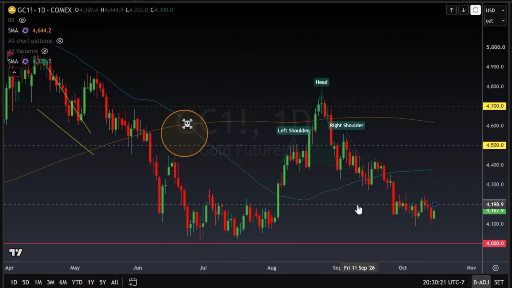
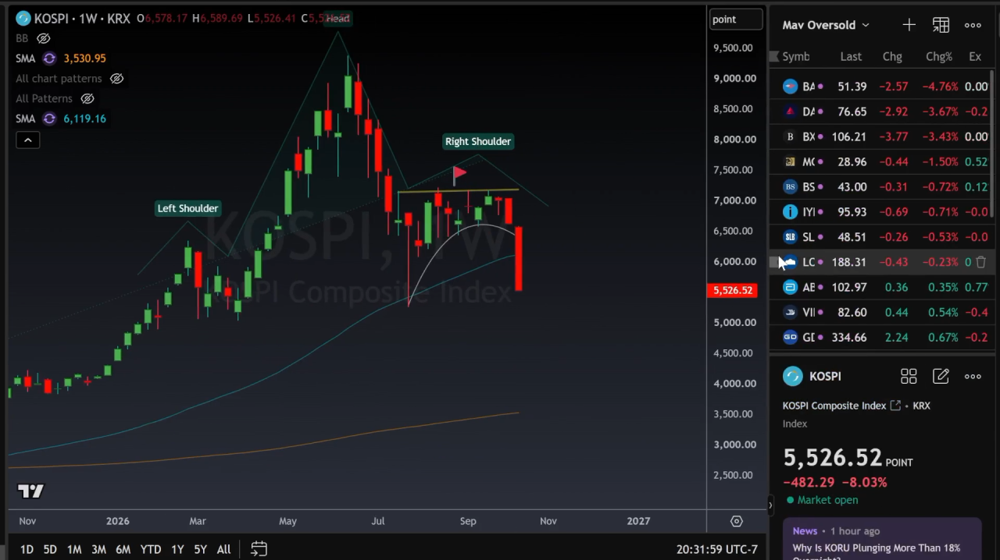
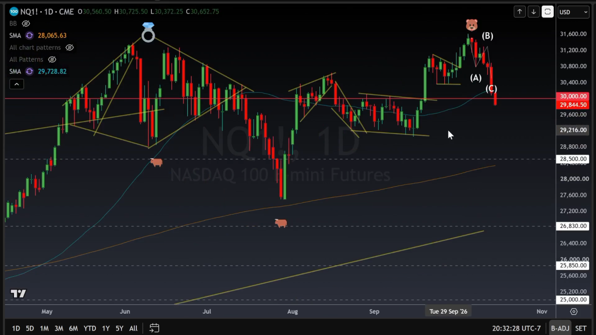
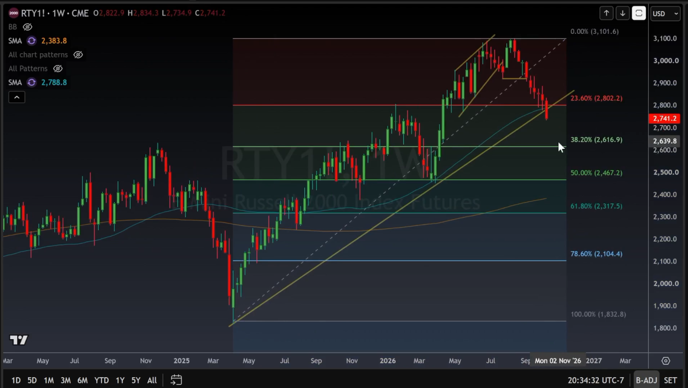
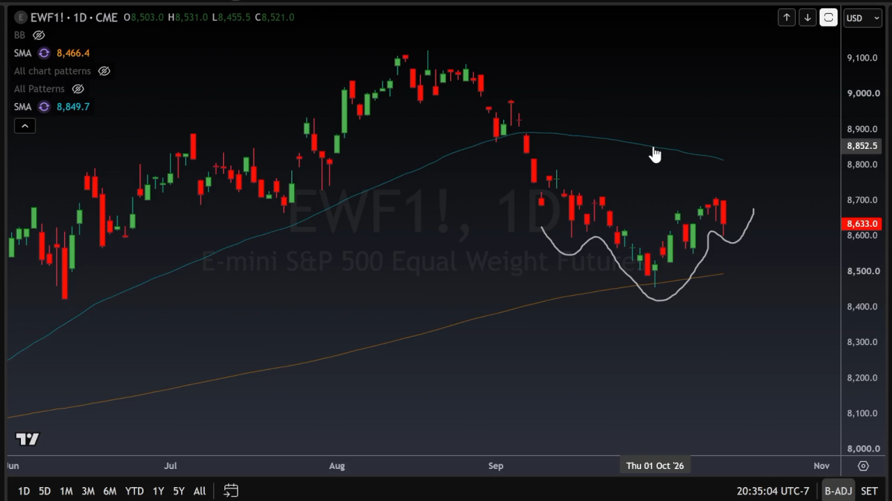
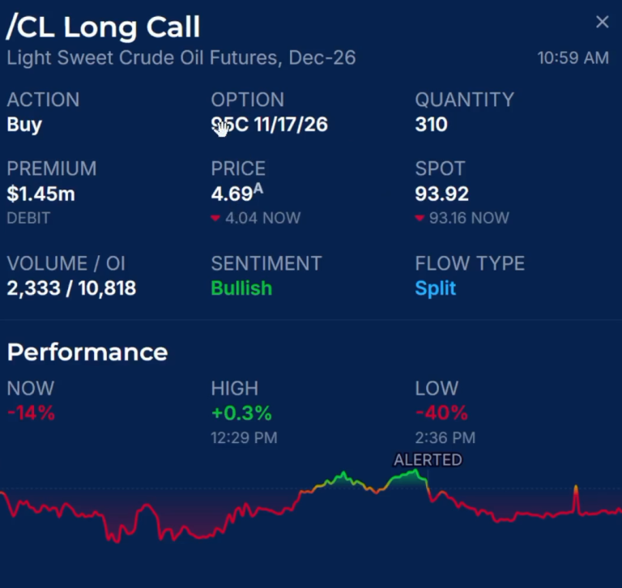
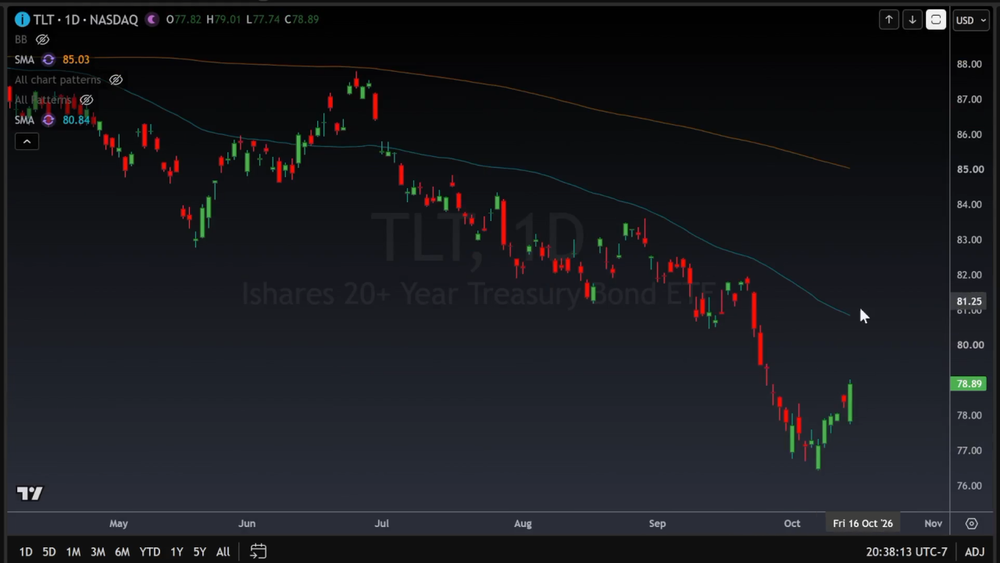

图1: 30年降低，因为大家都准备开始买Bonds，不买股票了。
图2: “美联储不会加息加的太多，因为股市可能要跌”
图3, 4: 早晨美金升黄金跌。现反之亦然。 看似，内幕的人开始为市场暴跌作出某种准备。大部分的资金开始进入防守状态。 如果Portfolio Manager开始抛高风险买低风险，这种市场前景非常不理想。我们长期持有的仓位就需要买Put和Sell Call来保护。
图5: 韩国开始暴跌，那些抵押韩国股票爆仓的人会引发附带伤害
图6: 基本上，纳斯达克今年从5月份混了个白玩儿。
图7: Russell 也不理想。 我会开始买Put保护我的3月份仓位企图止损。 
图8: 如果EWF不上涨的话，我对整个市场会十分悲观 - 因为Equal weight指数见弱意味着整个市场都要进入熊市。 这对我手中持有的期权不理想，我的股票会需要巨大量的Put来保护和回本。 

图9: 有一个人觉得油会升。 
图10: 同一个人认为3月份油会跌。他可能认为我们整个市场都会崩盘。 
图11: 这个人的布局让我认为我手中的TLT可以再持有一段时间。
图12: 他觉得30年还会继续跌 - 市场可能会进入某种全面暴跌。

<!-- images -->
## 图表

1. 
2. 
3. 
4. 
5. 
6. 
7. 
8. 
9. 
10. 
