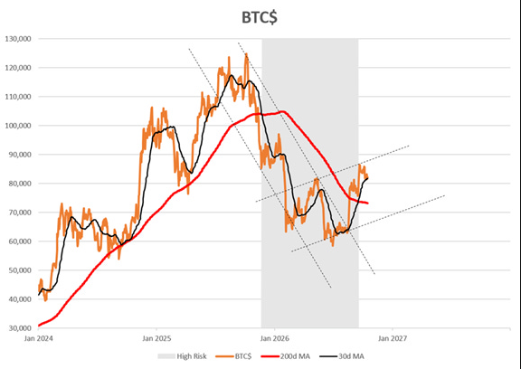
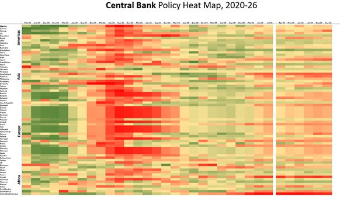
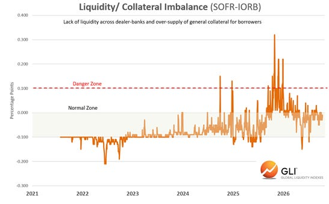
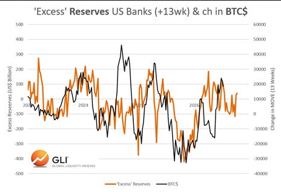
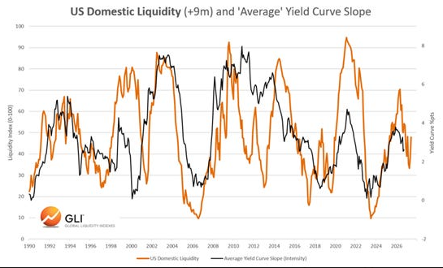
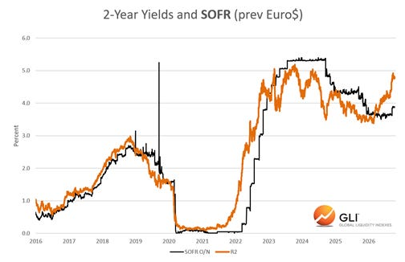
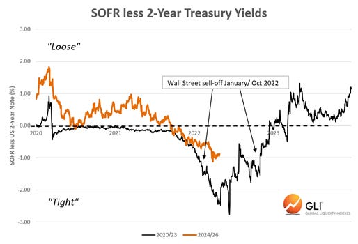
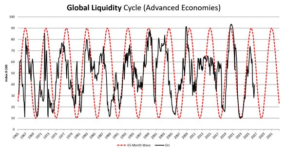

# 投资者是否正接近2027年流动性周期的回升阶段？
Michael Howell｜2026年10月16日（用户转发的中文译文，原样存档）

我们经常把比特币称为全球主要资产中对流动性最敏感的资产。如果这个判断大致成立，那么它近期的表现就值得关注。比特币最近的企稳与反弹，或许正在传递有关西方货币政策走向的重要信号，尤其是美联储在流动性方面的操作。

要理解这一点，还需要考虑另外两个现象。

首先，全球市场背负着庞大的债务负担，这限制了政策制定者收紧金融条件的力度。其次，黄金价格似乎越来越受到中国货币环境及中国人民银行政策的影响，而非仅仅受西方货币政策驱动。

因此，比特币或许成了一个能够更直接、更少受到其他因素干扰的美国及西方流动性晴雨表。

如果政策制定者确实受到现有债务规模的制约，那么，对于任何表明紧缩阶段开始缓和的迹象，我们都应格外留意。

下图展示了比特币的趋势与交易区间。最近这次看似出现的趋势反转，是否正在向我们传递某种信号？

## 各国央行正在踩刹车，但力度温和

美联储仍是关键角色。其他主要央行通常也会朝着大致相同的方向行动，只是节奏和力度有所不同。

下方热力图显示，目前多数央行采取的货币紧缩措施都较为温和。图中，红色代表流动性偏紧，绿色代表流动性宽松。因此，图表以粉色和橙色为主，说明全球流动性环境处于温和收紧状态，而非激进紧缩。

图中两组数据分别展示了2020年以来各季度的状况，以及截至9月底最近六个月的状况。

## 沃什／贝森特主导下的美联储

美国的政策框架值得进一步审视。 我们认为，货币政策的三个维度，正越来越多地由美联储与美国财政部以隐性的方式共同承担：

- 利率政策：美联储逐渐减少对前瞻指引的高度依赖，转而更加关注债券市场释放的信号，其中可能包括期限溢价的变化。
- 货币市场流动性：美联储力求维持“充足”的银行准备金，确保回购市场和抵押品市场平稳运行。
- 抵押品波动率：美国财政部通过调整国债发行结构和开展国债回购操作，影响市场运行，并帮助抑制国债市场的过度波动。这类波动可通过 MOVE 等指标反映。

这三个维度共同决定了美国整体的货币环境。 关键在于，流动性已不再只是政策利率的问题。联邦基金利率是限速牌，流动性是油门，而 MOVE 指数则反映交通状况。 但 MOVE 不仅仅是一个观察指标。抵押品波动率下降，可以提高美国国债作为抵押品的实际效用，从而增强金融机构的资产负债表承载能力，并提高抵押品乘数。与此同时，充足的货币市场流动性提供了融资，使这些抵押品能够被用于杠杆融资。 换句话说，准备金提供燃料，而抵押品的波动率则影响这些燃料能够被多高效地利用。 这种组合对于维持金融稳定，以及避免融资压力最终演变为系统性危机，都至关重要。

## 回购市场提供了线索

下图展示的回购利率与准备金余额利率（IORB）之差，反映出近期回购市场的稳定状况。 这一利差曾在2025年末急剧扩大，随后得到控制，并逐步回到较为正常的波动区间。

2025年末的这次事件十分重要，因为它清楚地展示了其中的运作机制。

随着美联储尝试缩减资产负债表，银行准备金随之下降，货币市场流动性也逐渐收紧。当准备金接近银行认为不足的水平时，市场对额外流动性的需求急剧增加，推动回购利率面临上行压力。

美联储随后通过准备金管理购买（Reserve Management Purchases，简称 RMPs）作出回应。这些操作除了名称不同，本质上就是量化宽松（QE）。无论冠以什么名称，其经济效果都很明确：购买资产会向银行体系注入准备金，支持货币市场流动性，并扩大美联储的资产负债表。

这对比特币至关重要。

如果比特币确实对边际流动性格外敏感，那么，超额准备金的变化最终应当反映在比特币价格上。这里的“超额准备金”，指的是实际准备金相对于我们估算的银行“充足”准备金需求水平所多出的部分。

下图正是对这一判断的检验：将超额准备金数据向后平移三个月，与随后比特币价格的变化进行比较。两者呈现出相当不错的关联性。

这其中的含义耐人寻味。比特币或许并不是在告诉我们当下的流动性处于什么水平，但它的企稳，可能为边际流动性环境接下来的走向提供线索。

## 展望未来：倾听债券市场的信号

货币环境中的压力往往最先在债券市场显现，因此，债市传递的信号值得密切关注。

下图将我们衡量美国整体流动性的月度指标向后平移九个月，与美国国债收益率曲线的斜率进行比较，以观察流动性变化对后续收益率曲线走势的指示作用。

近期收益率曲线趋于平坦，与美国流动性仍处于下行阶段的情况相吻合。

但情况可能已经开始发生变化。

最新的9月流动性数据出现波动，其中反映出来自美联储的流动性有所改善。美联储是否正在有意放慢紧缩步伐，使实际紧缩速度低于市场的预期？

支持这一判断的证据，来自担保隔夜融资利率（SOFR）与两年期美国国债收益率之间的利差。SOFR 是回购市场的关键融资利率。

两年期美债收益率往往能提前反映市场对美联储政策的预期。

根据我们的解读，最新的 SOFR 与两年期美债收益率之差表明，新任沃什领导下的美联储，其收紧货币环境的速度，可能仅为鲍威尔在2021至2022年那轮紧缩期间的一半左右。详见下图：

美国当局面临两大约束。首先，庞大的债务负担，使剧烈且持久的货币紧缩变得越来越危险。其次，随着美国与中国之间的资本战争不断升级，政策制定者没有多少理由人为制造一场本可避免的国内衰退，或破坏美国国债融资市场的稳定。

这意味着一个重要的变化。

## 流动性下行周期或正接近拐点

现有证据尚不足以证明新一轮流动性上行周期已经开始。但越来越多的迹象表明，紧缩步伐可能正在放缓。

我们原本预计，全球流动性周期将在2027年下半年见底。现在，我们可能需要重新评估这一时间点，或许将其提前数月。

种种迹象显示，回购市场已经趋于稳定，准备金流动性有所改善，债券市场的信号指向一条更为温和的紧缩路径。而比特币在经历近期疲软后，似乎也正在企稳。 单独来看，这些信号都不足以下定论。 但综合起来，它们提出了一种更值得关注的可能性：美国流动性周期距离下一个向上的拐点，或许比投资者目前认为的更近。 这也让我们再次回到比特币。 如果比特币确实是全球主要资产中对流动性最敏感的资产，那么，它近期的稳定表现或许并非单纯的市场噪音。 这可能是流动性潮汐开始转向的早期信号。接下来，比特币的价格表现将是一个关键检验：它需要守住7万美元上方。让我们拭目以待。
