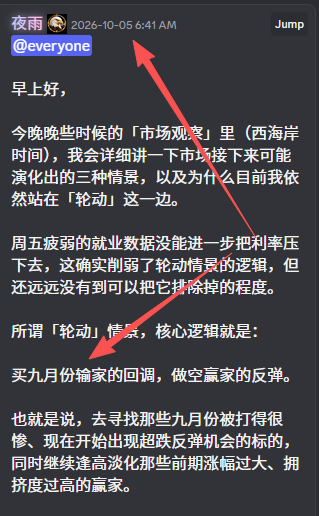
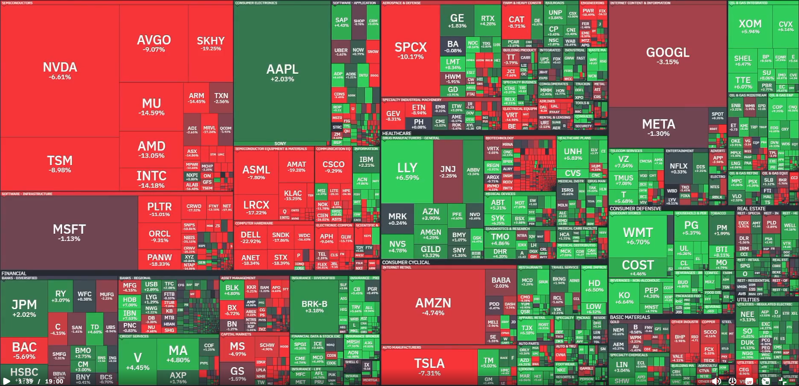
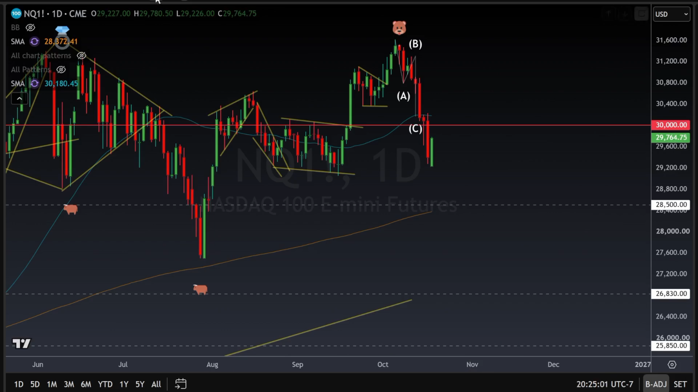
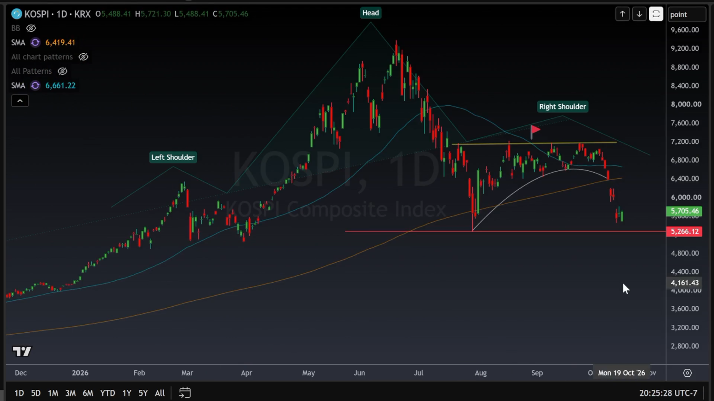
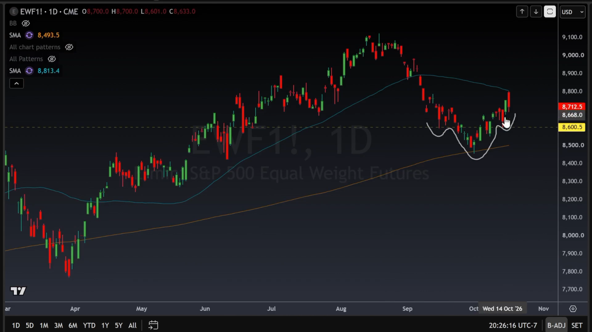
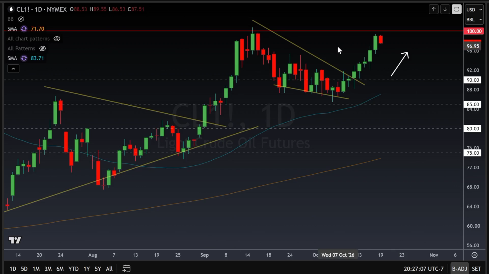
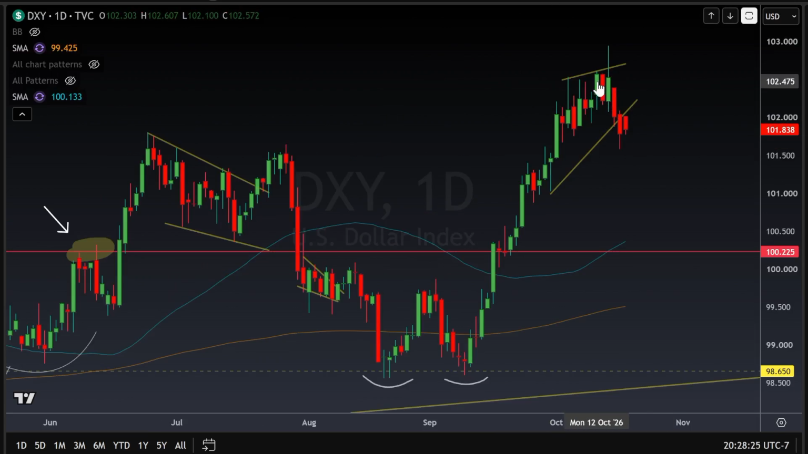
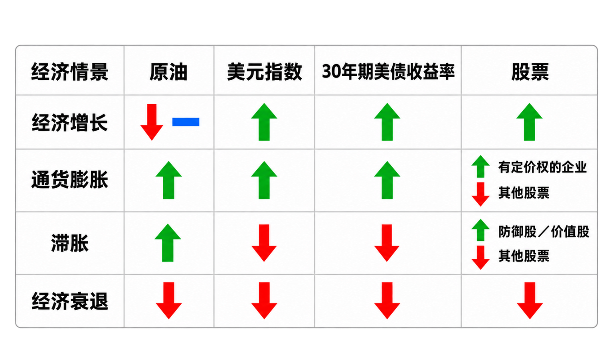
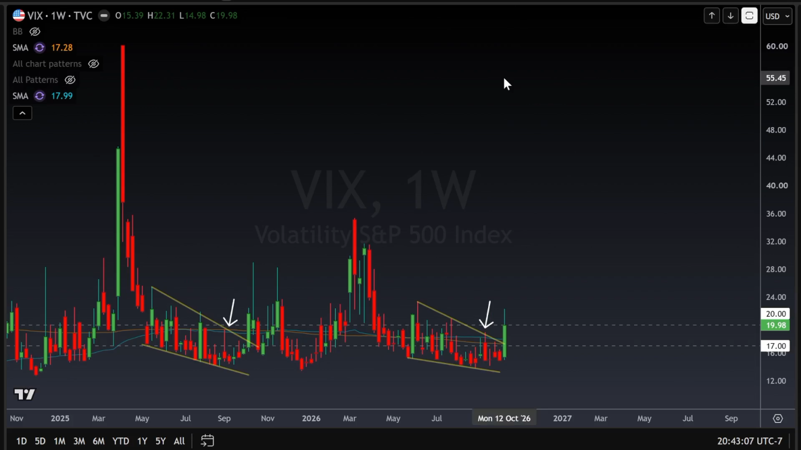
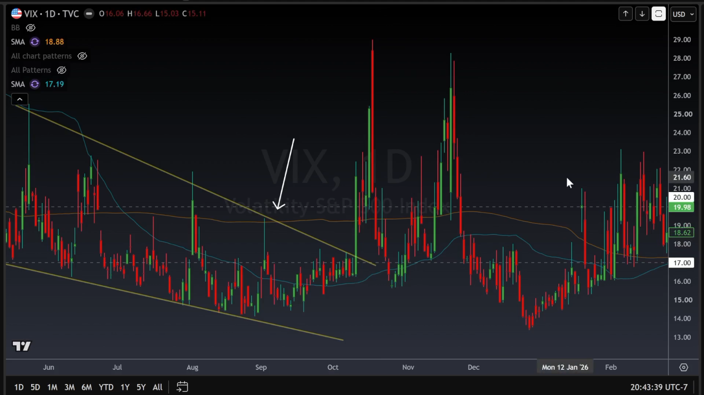

# 死猫反弹，还是市场见底？（大佬，2026-10-19，原文照录）

死猫反弹，还是市场见底？

图一： 两周前，市场还没开始拉稀的时候，我就说过：十月份，我们要买九月份的输家，卖九月份的赢家。

图二： 这张图正好验证了这个轮动逻辑。现在要判断的是：资金会不会反向轮动？还是整个市场一起涨、一起跌？我们逐张看。

图三： 纳指这波反弹看着不错。但这到底只是超跌反弹，还是一次健康回调已经结束，可以开始买了？

图四： 韩国市场才反弹了 0.6%。弱得可怜，跟他们男人的鸡巴一样，没什么说服力。我不信。这走势实在硬不起来，让我没有勃起下单的冲动。

如果韩国再拉一次稀，纳指很可能也跟着拉，重新翻绿。IWM 和 SPY 目前也都在反弹，看起来明天会是个好日子，对吧？

图五： 可惜，EWF 隔夜正在下跌。看起来，这轮轮动可能要结束，开始往回转了？

所以，我们接着看原油、美元和长端美债。

图六： 原油小幅回落，足够让纳指喘口气、往上弹一点。如果油价重新上涨，市场很可能又要卖下来。但如果油价继续下跌，这轮抛售可能已经结束了，至少短期如此。但如果原油重新涨破 100，纳指很可能还得继续跌。

图七： 最近美元下跌，原油上涨。市场其他板块喜欢这个组合，但科技股目前不喜欢，因为还叠加了美债下跌的压力。部分超跌股凑齐了反弹条件，所以能往上走。但如果油价继续上涨，连防御股也得遭殃。

图八： 怎么判断接下来市场往哪边走？看这张图。

图九： 这张图我已经连续发了几个星期，现在终于等到了 VIX 飙升。但我还想让你们看一个东西……

图十： 去年 VIX 是在 10 月 10 日，星期五飙升的；今年则是在 10 月 16 日，同样是星期五。那去年接下来发生了什么？周一先降温，然后又往上冲了一波。

今年可能再次出现类似的节奏。如果真的重演，那这就是死猫反弹，每一次反弹，都是让你趁崩盘前，把手里的破玩意儿卖掉的机会。

祝好运！

