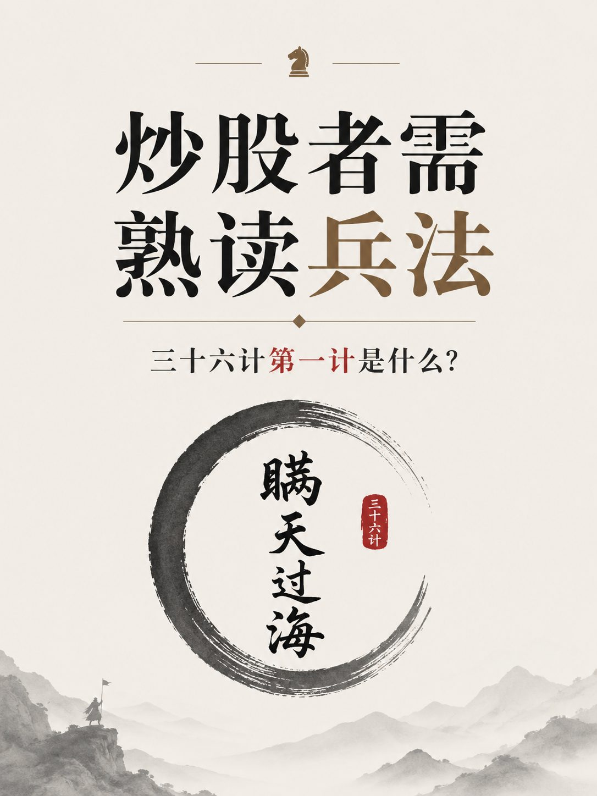
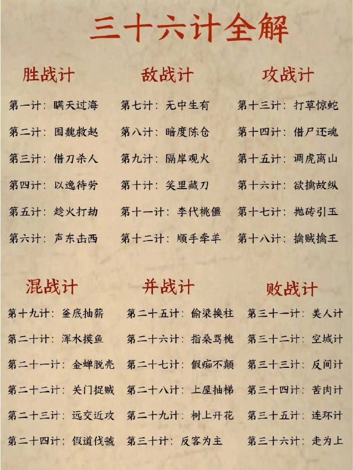

# 战场：兵法、不确定性与战术意识

_原文部分逐字保存（只把作者名换成 [导师]、群友名换成 [群友]；链接保留）。每段的来源行号和 sha256 在 `<!-- verbatim … -->` 标记里，`manifest.json` + `test/psych.test.ts` 校验能逐字还原原文件。下面的「DK 整理」是 DK 写的，不是导师原话。_

## 原文（逐字）

<!-- verbatim psych-batch-1.txt L68-L69 sha256=58a52a1020acddde -->
韩非曾经说过： 兵不厌诈。 股市不是一个创造财富是地方，而是掠夺财富的地方。也就是说，它是一个战场。 战场上用的是兵法。你不懂兵法就会赔钱。

<!-- /verbatim -->

<!-- verbatim psych-batch-1.txt L96-L106 sha256=07017ecfd3d79845 -->
中国的教育系统普遍习惯于“喂”知识：老师给出问题，也给出标准答案，学生的任务更多是记住并掌握答案。

但股市恰恰相反。股市是一个非常恶劣、甚至残酷的学习环境。 很多时候，结果本身带有很大的随机性。你做对了，不代表你的逻辑一定对；你做错了，也不代表你的逻辑一定错。一次盈利可能只是运气，一次亏损也可能只是概率的一部分。

所以，当你们问我一些非常具体的问题，比如“明天一定涨还是跌？”“几点见顶？”“这个价格是不是绝对的底？”——很多时候我没有办法回答。

因为这些问题本身就没有确定的答案。任何声称自己知道确定答案的人，大概率不是比别人更聪明，而是在骗你，甚至是在骗自己。

在股市里真正需要学习的，不是寻找一个永远正确的“标准答案”，而是学会在信息不完整、结果不确定的情况下做判断：理解概率、控制风险、接受错误，并且在错误的时候活下来。

<!-- /verbatim -->

<!-- verbatim psych-batch-1.txt L353-L406 sha256=5b5f0393ff9e0c4e -->
很多人喜欢问我一个确定的答案：

“到底会不会涨？”
“现在能不能买？”
“你觉得一定会跌吗？”

但我其实很不愿意给这种 definitive answer（确定答案）。

因为一旦我把话说得太绝对，就很容易有人把我的判断当成“答案”，然后重仓、加杠杆，甚至拿它去赌。

最后我的判断可能只错了一点，但他因为错误地使用这个信息，亏了很多钱。

所以在我还没有确认一个人能够负责任地使用信息之前，我通常不会给非常明确、非常坚定的建议。

这不是因为我不愿意告诉你我的判断。

而是因为在股市里：

一个判断本身有多准确，和你能不能靠它赚钱，是完全不同的两件事。

真正成熟的交易者听到的是：

“这是一个概率较高的判断，我应该怎么控制风险？”

不成熟的交易者听到的却是：

“他说会涨，那我梭哈。”

所以有时候，我越了解一个人怎么交易，反而越敢把自己的真实判断告诉他。

股市很讨厌的一点，就是你必须在信息不完整、局势不明朗、答案不确定的情况下，做出一个本身也不可能完美的决定。

而这恰恰和学校教我们的东西背道而驰。

学校习惯告诉我们：题目有标准答案。只要掌握足够的知识、收集足够的信息，就能找到那个“正确答案”。

但股市不是考试。

你永远不可能掌握所有信息，也几乎不可能得到一个 definitive answer（确定答案）。

你能做的，只是在当下有限的信息里，判断：

什么最有可能发生？
如果我对了，能赚多少？
如果我错了，准备亏多少？

然后做一个不完美的决定，并承担它的结果。

所以交易真正考验的，不只是你知道多少，而是你能不能在没有标准答案的情况下依然做出决定，同时控制犯错的代价。

如果你一定要等到答案完全确定才行动——

那你在股市里大概率永远等不到。

<!-- /verbatim -->

<!-- verbatim psych-batch-1.txt L450-L458 sha256=f43197b177af8cda -->
中国人学中国文化。

这本书会让你明白股市。 

兵不厌诈。股市就是现代骗术和兵法的最佳布局。

商场。情场。战场。选一做你的教室。

<!-- /verbatim -->

<!-- verbatim psych-batch-1.txt L755-L812 sha256=2d3625e4e500e050 -->
股市里的 Tactical Awareness（战术意识）是什么？

简单来说：

你不光要知道自己想做什么，还要随时知道市场正在干什么。

一个好的交易员进场以后，不会停止思考。

你要不断观察：

今天是趋势行情还是震荡行情？
成交量正常吗？
VIX、美元、美债收益率在干什么？
哪个板块在带盘？哪个板块在拖累？
今天、明天有什么重要数据？
我的股票有没有跟着大盘走？
我的预期有没有得到市场确认？
如果我的判断错了，我在哪里认错？

比如你认为一只股票要跌。

“我觉得它会跌”不是交易理由。

跌破支撑、放量、反抽失败、卖盘继续出现——这些才是在告诉你：

市场开始证明你的判断。

反过来也一样。

你本来判断它会跌，但它跌不下去，支撑不断有人买，大盘开始反弹，板块也转强。

这时候最愚蠢的事情就是：

“但是我还是觉得它应该跌。”

市场不在乎你觉得什么。

战术意识就是：

永远知道现在发生了什么，知道什么会伤害你，知道什么时候自己的剧本已经失效，然后及时调整。

你甚至可能长期方向判断完全正确，但因为短期战术错误，一样可以亏得一塌糊涂。

所以交易不是：

预测 → 买入 → 等结果。

而是：

观察 → 判断 → 确认 → 执行 → 再观察 → 调整 → 风控。

这整个循环，才叫交易。

方向决定你想往哪里走。

战术意识决定你能不能活着走到那里。

<!-- /verbatim -->

## DK 整理（不是导师原话）

- 三十六计 / 兵不厌诈（L68、L450 起，下图两张）：catalog source `owner-psychology` 之前审阅过这张图，但没有存档；现在存在 assets/。
- 确定答案不存在（L353 起）、战术意识（L755 起）= catalog `psych-tactical`、`psych-sample-review`；中国式“喂知识”（L96）只做文档。

_所有 Alpha 检查都只提示（warn / info），不阻止开仓；练习单唯一的硬要求仍是计划卡。默认值都未经检验，见 docs/DECISIONS.md 2026-10-17（交易心理）。_
