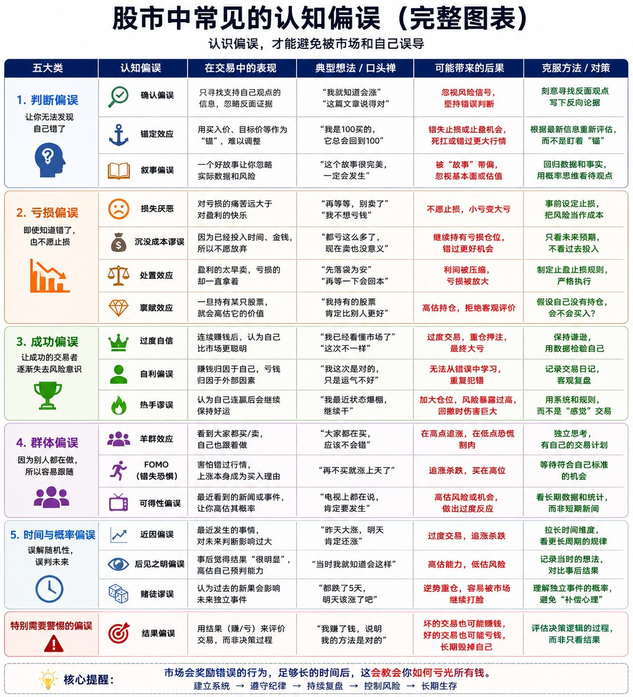

# 交易日记与结果偏误

_原文部分逐字保存（只把作者名换成 [导师]、群友名换成 [群友]；链接保留）。每段的来源行号和 sha256 在 `<!-- verbatim … -->` 标记里，`manifest.json` + `test/psych.test.ts` 校验能逐字还原原文件。下面的「DK 整理」是 DK 写的，不是导师原话。_

## 原文（逐字）

<!-- verbatim psych-batch-1.txt L533-L543 sha256=259cdb52defd3d51 -->
如何快速进步：交易日记 很多人交易结束以后，只看一件事： 今天赚了还是亏了？ 这是最慢的进步方式。 真正重要的不是结果，而是： 你为什么赚？为什么亏？ 每一笔交易结束后，记录几个问题： 

- 我为什么入场？
- 当时的 Thesis 是什么？
- 什么地方判断对了？
- 什么地方判断错了？
- 有没有违反自己的纪律？
- 如果重新来一次，我会怎么做？

 尤其要记录那些赚钱但做错了的交易。 因为亏钱会让你反思，赚钱却很容易把错误的行为奖励给你。 交易日记不是记录你的盈亏。 它是记录你的大脑。 市场每天都在给你考试。 不写交易日记的人，只是在不断参加考试。 写交易日记的人，才是在看错题本。

<!-- /verbatim -->

## DK 整理（不是导师原话）

- **交易日记 6 问**（L533 起）：`npm run paper -- journal --id … --why --thesis --right --wrong --violated --redo`；复盘卡显示答案和未答题。
- **赚钱但做错**：`--profitable-but-wrong yes|no` 确认；没确认时，盈利单带着违规或 warn 标签 → 自动候选（复盘卡 ⚠️）。算进交易信心的失败。
- **认知偏误图**（下图）：17 个偏误都已在 [BIAS_QUESTIONS.md](../../BIAS_QUESTIONS.md)（catalog `psychology.biases`）。对应关系（只做文档）：
  | 偏误 | Alpha 里的信号 |
  |---|---|
  | 过度自信 / 热手 | `warn_size_up_after_wins`、`warn_day_after_big_win`、euphoriaGate |
  | 沉没成本 / 损失厌恶 | `warn_add_to_loser_unconfirmed`、`warn_second_add_to_loser`、两次犹豫 #13 |
  | 从众 / FOMO | 七宗罪 嫉妒 envy、追价 chasing |
  | 锚定 / 熟悉度 | `info_ticker_magnetism` |
  | 叙事 / 近因 | `warn_72h_event`、市场确认 |
  | 结果偏误 | 赚钱但做错、亏损归因 variance |

_所有 Alpha 检查都只提示（warn / info），不阻止开仓；练习单唯一的硬要求仍是计划卡。默认值都未经检验，见 docs/DECISIONS.md 2026-10-17（交易心理）。_
