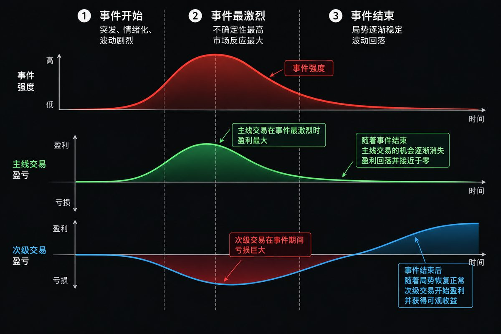

# 宏观二阶思维与事件生命周期

_原文部分逐字保存（只把作者名换成 [导师]、群友名换成 [群友]；链接保留）。每段的来源行号和 sha256 在 `<!-- verbatim … -->` 标记里，`manifest.json` + `test/psych.test.ts` 校验能逐字还原原文件。下面的「DK 整理」是 DK 写的，不是导师原话。_

## 原文（逐字）

<!-- verbatim psych-batch-1.txt L154-L158 sha256=80ee0fe092052939 -->
中国交易者面临的一个很大问题，是缺乏系统性理解。 很多散户的交易方式是：看几条新闻、听几个消息、买一两只股票，然后听天由命，等天降甘霖。 但市场根本不是这样运作的。 股票市场是一个复杂的生态系统。 它有自己的： 天气——地缘政治与宏观环境：战争、政策、利率、汇率、能源危机，决定市场今天刮什么风、下什么雨。 生物——交易者与机构：散户、基金、做市商、银行、对冲基金，每一种参与者都有自己的行为模式、利益和生存方式。 物理——期权与市场机制：Gamma、Delta、波动率、流动性、做市商对冲，这些力量像物理定律一样推动价格。 化学——公司基本面：营收、利润、现金流、债务、估值以及资本支出，各种因素互相作用，最终改变一家公司的性质。 地形——技术图表与价格结构：趋势、支撑、阻力、成交量、缺口、筹码密集区。图表不是水晶球，而是告诉你战场的地形在哪里。 而很多人不愿意理解这些东西，或者根本没有意识到它们之间是互相连接的。 他们习惯把股票理解成一个个孤立的信号： “出了利好，所以买。” “财报不错，所以涨。” “跌到支撑，所以抄底。” “战争爆发，所以买黄金。” 问题是，复杂系统从来不会由一个变量决定结果。 利好可以暴跌，利空可以暴涨；公司可以很好，股票却可以腰斩；技术面可以完美，却被一个宏观变量瞬间击穿。 如果你不能把市场看成一个相互作用的复杂系统，而永远只盯着一个个孤立的信号，那么真正的大行情来临时，你往往不会提前看到风险。 你看到的是一滴雨。别人看到的是整个天气系统。 这就是为什么有些人总觉得市场“突然”暴涨、“突然”暴跌。 很多时候，市场一点都不突然。 只是你没有看见风暴。

<!-- /verbatim -->

<!-- verbatim psych-batch-1.txt L841-L858 sha256=51c2e24717de14dc -->
三个宏观二阶交易例子

看空原油 → 买 JETS
油价 ↓ → 航空燃油成本 ↓ → 航司利润率改善 → 航空股受益。

押注加息 → 做空 IWM
利率 ↑ → 融资成本 ↑ → 小企业承压更明显 → 小盘股相对不利。

押注中东战争升级 → 关注航运保险/再保险
战争 ↑ → 航运风险 ↑ → 战争险保费 ↑ → 保险定价和保费收入可能上升。

但实际损失和赔付也会增加，所以不是单向关系。

核心逻辑：不要只交易事件本身，要交易事件的传导链。

宏观事件 → 成本/价格/需求变化 → 谁受益、谁受损 → 找到交易标的。

<!-- /verbatim -->

<!-- verbatim psych-batch-1.txt L918-L951 sha256=c22e844cb9bdd60c -->
这周很多人问我几个问题： 

- 怎么才能成为更好的宏观交易者？

 

- 有没有什么书可以看？或者有没有一套系统性的学习方法？

 

- 你平时是怎么想到像“美联储信誉交易（Fed Credibility Trade）”这种逻辑的？

 

- 为什么这种交易思路在华人交易圈里相对少见？

 ----- 我回答这些问题没有任何偏见，也没有贬低任何人的意思。只是分享我自己的观察和经验。 

1. 学历史。

 不是背年代、背事件，而是去理解一件事为什么发生，它导致了什么，之后又引发了什么。 研究的是因果关系。 很多所谓的“未来”，其实都能在过去找到影子。历史不会完全重复，但人的行为、利益冲突和群体心理经常重复。 未来往往藏在过去里面。 

2. 其实没有哪一本书能真正教你怎么做宏观交易。

 因为宏观交易本身很难被整理成一个固定的、系统化的公式。 它更像是很多能力长期叠加出来的结果：历史、经济、金融、政治、企业、市场心理，再加上你自己多年观察市场形成的判断力。 这些东西不是看完一本书就突然会了，而是几年甚至几十年慢慢积累出来的。 

3. 这也解释了为什么很难找到一本书直接告诉你怎么提前想到“Fed Credibility Trade”这种逻辑。

 说得现实一点： 如果一个人真的能够长期看到这么远，而且能够把这种判断稳定地转化成交易，他大概率已经在安静地赚钱了，而不是每天写文章告诉别人下一步应该怎么做。 真正有价值的判断能力，本身就是非常稀缺的。 

4. 我个人对中国教育体系其实有不少批评。

 我觉得它非常擅长训练人去寻找“标准答案”，但不太擅长训练人去质疑前提。 而宏观交易恰恰经常要求你问： 如果市场共识是错的呢？为什么所有人可能都错了？我自己又可能错在哪里？ 你必须能够接受自己不断犯错、推翻自己原来的判断，然后重新建立逻辑。 如果一个教育环境过度强调标准答案、权威和“不要犯错”，那确实不太容易培养出这种交易思维。 所以为什么这种交易方式在华人交易圈里相对少见，我认为这可能是其中一个原因。 很抱歉，我没办法给大家一个： 第一步做什么、第二步读什么、第三步就能成为宏观交易者 这样的攻略。 因为现实是，最后决定你能不能做好宏观交易的，是你对群体心理、国际经济、公司金融、财政政策、货币体系和银行体系运行逻辑的综合理解。 这些东西最后必须在你的脑子里面连成一张网。 当一件事情发生的时候，你不是去寻找一个标准答案。 而是能够自己推演： 接下来谁会受到影响？谁会做出反应？这个反应又会影响谁？ 这才是宏观交易真正需要训练的能力。

<!-- /verbatim -->

<!-- verbatim psych-batch-1.txt L952-L974 sha256=7a16576f956a64d1 -->
宏观事件，尤其是战争、制裁、能源冲击、央行政策这类事情，最麻烦的地方在于：市场可以突然完全不按照你的原始逻辑走。 这时候最危险的不是亏损本身，而是你开始为了证明自己是对的，不断加仓。 我的处理方式很简单： 

1. 先问自己：原来的交易逻辑还成立吗？ 如果逻辑已经被新的宏观信息破坏，就不要因为“已经亏了很多”而继续拿。

 

2. 区分价格波动和逻辑失效。 价格暂时逆着你走，不代表交易一定错；但如果推动这笔交易的核心变量已经改变，就必须重新评估。

 

3. 不要情绪化补仓。 亏损仓最多只能有一次有计划、有纪律的加仓。第二次、第三次不断往里面塞钱，通常已经不是交易，而是在赌反转。

 

4. 用对冲争取时间。 如果宏观事件方向高度不确定，与其立刻砍掉所有仓位，有时候可以用指数、行业ETF或期权建立反向仓位，把组合波动压下来，再观察市场如何消化消息。

 

5. 控制仓位比预测方向更重要。 真正成熟的交易者不是每次都猜对，而是猜错的时候还能活着。

 宏观交易里，你永远控制不了下一条新闻。 你能控制的只有三件事：仓位、风险和退出。 不要想着把每一笔亏损救回来。 有些交易最好的管理方式，就是承认世界变了，然后离场。

<!-- /verbatim -->

## DK 整理（不是导师原话）

- 三个宏观二阶交易例子 + 事件生命周期（L841 起，下图）= catalog `psych-second-order`；扩展见 [better-macro-trader.md](../better-macro-trader.md)、[market-scenario-matrix.md](../macro/market-scenario-matrix.md)。
- 战争/制裁/能源/央行（L952 起）→ `src/macro/` 宏观简报；没有新检查。

_所有 Alpha 检查都只提示（warn / info），不阻止开仓；练习单唯一的硬要求仍是计划卡。默认值都未经检验，见 docs/DECISIONS.md 2026-10-17（交易心理）。_
