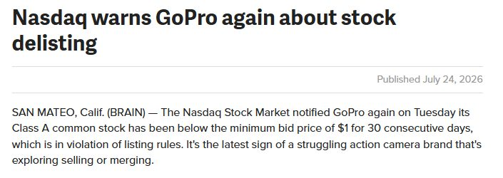

# 导师的作息、周末作业与起步经历

_原文部分逐字保存（只把作者名换成 [导师]、群友名换成 [群友]；链接保留）。每段的来源行号和 sha256 在 `<!-- verbatim … -->` 标记里，`manifest.json` + `test/psych.test.ts` 校验能逐字还原原文件。下面的「DK 整理」是 DK 写的，不是导师原话。_

## 原文（逐字）

<!-- verbatim psych-batch-1.txt L346-L352 sha256=781cb4c1383d883f -->
学英语。 

够看期权的就可以。

能看明白新闻的更好。

<!-- /verbatim -->

<!-- verbatim psych-batch-1.txt L438-L449 sha256=fc347698ae2f7a71 -->
知道为什么周末没有闲聊吗？

因为没有人知道下周会怎么走。

但是你知道你上周犯了什么错误。

复盘。写日记。学知识。别偷懒。 

“君子博学而日参省乎己，则知明而行无过矣。"

荀子。

<!-- /verbatim -->

<!-- verbatim psych-batch-1.txt L459-L484 sha256=9fbeb5fc44684f4c -->
你可以从我这里期待什么

我的强项

叙事投资 —— 我更擅长从群体心理、应用经济学、地缘政治和利益关系去判断市场，而不是单纯等一张图告诉我接下来会发生什么。

灵活应变 —— 我把股市看成一个不断变化的战场，而不是固定的堑壕战。战场变了，仓位、策略，甚至我的观点都会跟着变。

谨慎 —— 我永远假设自己会犯错。我非常谨慎，也始终保持警觉，不断问自己：“如果我错了怎么办？”

生存 —— 我会教你如何在市场里活下去，直到有一天你有机会实现财务自由。先活下来，再谈赚钱。

我的弱项

技术与数学 —— 跟着我，你一定会错过一些机会。纯技术面、量化和数学模型并不是我最擅长的领域。

确定性 —— 我无法预测市场。我会犯错，证据变了，我也会改变观点。

信念 —— 我无法把 Conviction 传给你。我可以告诉你我是如何形成信念的，但最终你必须自己得出结论。

梦想 —— 我不擅长卖给你“财务自由”的梦想。很多时候，这条路一点都不精彩，甚至会像一场缓慢而漫长的死亡磨炼。

我可以教你如何在这条路上活下来。

但我没办法让这条路变得好走。

<!-- /verbatim -->

<!-- verbatim psych-batch-1.txt L544-L546 sha256=bf54d3e08c7375a9 -->
修编：西海岸时间，与纽约相差-3. 我的日常作息 04:30 — 起床 冥想 · 喝茶 · 做家务 05:30 — 隔夜信息整理 补看隔夜新闻、地缘政治和重要市场事件。 06:00 — 盘前期货 观察期货，阅读相关新闻和市场动态，准备当天交易。 06:30 — 平仓 管理并关闭已有仓位。 07:30 — 收集市场数据 记录数据、观察市场变化。 08:30 — 个人时间 家务 · 阅读 · 电影 · 电视 11:00 — 早餐 12:00 — 市场复盘 复盘当天市场，为下一轮交易做准备。 12:30 — 开仓 建立下一阶段的交易仓位。 13:00+ — 生活 打高尔夫 · 徒步 · 开船 · 和朋友玩 · 做饭 · 和漂亮女人干一些不太正经的事情。 18:30 — 加餐。如果当天没有锻炼，晚餐可选；如果进行了锻炼，则安排晚餐补充能量。 22:00 — 亚洲期货 观察亚洲市场和期货，阅读相关新闻、政策变化和重要市场事件。 00:00 — 北美期货 观察北美隔夜期货，阅读相关新闻、经济数据和市场动态。 01:30 — 睡觉 然后第二天，重新来一遍。

<!-- /verbatim -->

<!-- verbatim psych-batch-1.txt L547-L653 sha256=45f8bab78b77b7bb -->
我最开始炒股的时候，账户里只有 3000 美元。

第一个月，我就亏掉了差不多一半。

原因也很简单：

因为那时候我他妈根本不知道自己在干什么。

我专门买那些特别便宜的垃圾仙股。几分钱一股，公司没什么未来，基本全靠吹牛逼。至于它们到底在干什么，我那时候其实也看不懂。

但不知道为什么，我运气特别好。

其中有一只股票，我大概 $0.05 买进去。

一个星期以后，它涨到了差不多 $1。

我卖掉以后，不但把之前亏的钱赚回来了，账户反而多赚了大概 5000 美元。

然后我第一次开始认真思考一个问题：

为什么偏偏是这只股票让我赚到了钱？

我回头去研究这家公司。

结果越看越不对劲。

最后我发现——

这家公司在撒谎。

而且不是什么小谎。

是他妈什么都在撒谎。

他们当时已经收到了 NASDAQ 的退市通知，因为不符合资本要求。正常情况下，接下来就是退市。

但公司当然不想退市。

所以他们开始疯狂发新闻。

今天宣布一个项目。

明天宣布一个合作。

后天又是什么“重大进展”。

反正就是不断制造故事、制造预期、制造炒作，把股价往上推。

因为只要股价能拉起来，他们就有机会融资，也有机会重新满足上市要求。

然后我突然明白了一件事：

哦，原来还能这么玩。

更重要的是，我很快发现——

这么玩的公司根本不止一家。

很多垃圾股，尤其是 OTC，套路都差不多。

于是接下来的两年，这基本就成了我的主要策略。

我专门去找那些快要被退市、快要死掉，但管理层又拼命想把公司救回来的股票。

然后一次买好几只。

买完以后就等。

有时候一等就是几个月。

但我根本不需要每一只都赚钱。

我买四五只，哪怕三四只最后死掉，只要其中一只突然涨十倍、二十倍，基本就能把其他所有亏损全部赔回来。

有时候更离谱。

他妈的几只一起涨。

所以那几年，我的账户增长得非常快。

到了第二年，正好赶上全球金融危机接近尾声。

我 19 岁。

已经开上了 Porsche Cayenne。

后来资金越来越多，我也开始觉得不能永远这么赌垃圾股，于是逐渐买一些比较正常的公司，开始建立自己的 portfolio。

而且说实话，那些股票后来表现都不错。

问题只有一个：

太慢了。

我没有耐心等三年、五年，看一家公司慢慢成长，然后赚个百分之几十。

而那个年代，Options 才刚刚开始逐渐普及，远远没有过去十年这么流行。

于是我又开始思考一个问题：

如果我已经学会了怎么判断一只股票会不会涨，有没有一种工具，可以让我在看对的时候，把同样的判断放大十倍、二十倍？

答案，就是 Options。

而这也是我真正开始学习期权的原因。

<!-- /verbatim -->

<!-- verbatim psych-batch-1.txt L661-L665 sha256=883943a0275bb74e -->
周末作业。可以用翻译字幕。 
这是你在市场上最大的对手。你需要知道Market Makers如何操盘。 
你们一定要花时间明白这个话题，对你长期盈利非常重要。
https://www.youtube.com/watch?v=N17Rp4gnLfQ

<!-- /verbatim -->

<!-- verbatim psych-batch-1.txt L666-L687 sha256=6104c002ea31394d -->
周末提醒一下： 虽然周末不开盘、不交易，但这两天其实非常适合用来提升自己。 

1. 复盘 + 写交易日志

回顾这周做过的交易： 为什么赚？为什么亏？ 是判断正确，还是只是运气好？ 是逻辑出了问题，还是执行出了问题？ 

2. 补宏观经济知识

我平时会发很多宏观、利率、美元、债券、地缘政治等方面的内容，有些甚至要往前看一两个星期。周末正好把没看完的补上。 宏观不一定直接告诉你“明天买什么”，但它会帮助你理解为什么股票会这样走，长期下来会让你成为更好的交易者。 

3. 多读东西

不一定非要一本书从头啃到尾。现在有 AI，可以让它帮你整理一本书最重要的章节、观点和知识。 重点不是“读完多少本书”，而是不断扩大自己的知识面和认知。 

4. 学一点英语

如果英语不是你的强项，建议慢慢补。 你不需要英语说得多流利，也不需要写得多漂亮。但至少要能看懂基本的财经新闻、公司公告、期权和股票术语，以及券商里的各种交易指令。 毕竟我们交易的是美股，懂一点英语会让你少很多信息差。 

5. 最后，该休息就休息

不学习的时候就别一直盯着股票。 好好吃饭、运动、出去走走、培养自己的兴趣爱好、陪陪家人朋友，把身体照顾好。 交易是长期的事情。周末不开盘，不代表你必须继续“交易”。 该复盘的时候复盘，该学习的时候学习，该休息的时候休息。 祝大家周末愉快。

<!-- /verbatim -->

<!-- verbatim psych-batch-1.txt L748-L754 sha256=30bb38e592f0d85b -->
大家好。 群里的[群友] 把上周末关于Market Maker的视频给翻译了并且添加的中文字幕。

谢谢你！

这个视频非常非常重要 - 看完了以后你会明白Market Maker扮演的角色，以及他们如何控制股票价钱和给期权定价钱。 
https://1drv.ms/f/c/cb81cc2b04f90353/IgBrfazUBZB3QpFxT1qLZstnAToqnUgkxj_OLekNJHmG7mg?e=EdqTus

<!-- /verbatim -->

<!-- verbatim psych-batch-2.txt L41-L42 sha256=5172802378fad868 -->
“你能总结一下你的策略吗？我不太知道怎么定位你的交易系统。” 看人。看新闻。喝酒。睡女人。赚钱。 真的，我没什么专一策略。我看股市写什么剧本就接什么货。我觉得能赚钱都是好策略。 股票对我来说不是赚钱的快感而是可以判断未来会发生什么事情的精准度。那种认可是最有意思的。

<!-- /verbatim -->

## DK 整理（不是导师原话）

- **周末作业 / 周末清单**（L438、L666 起）→ [docs/ROUTINE_WEEKLY.md](../../../docs/ROUTINE_WEEKLY.md) 周末清单（手动）。
- 导师作息（L544，西海岸时间）、起步 3000 美元 + GoPro 退市警告（L547 起，下图）：只做文档。
- Market Maker 视频（L661、L748）：链接保留在原文；视频本身没有存档。
- 策略总结（batch-2 L41）。学英语（L346）。

_所有 Alpha 检查都只提示（warn / info），不阻止开仓；练习单唯一的硬要求仍是计划卡。默认值都未经检验，见 docs/DECISIONS.md 2026-10-17（交易心理）。_
