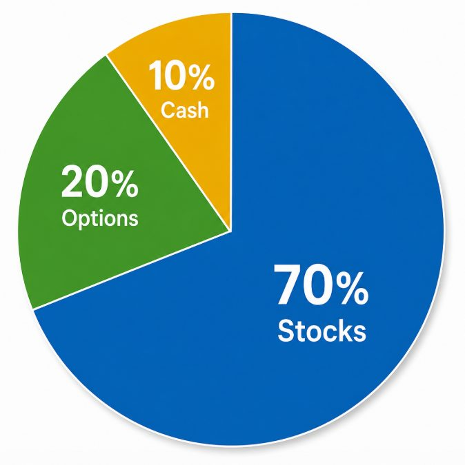

# 钱、生活与复利

_原文部分逐字保存（只把作者名换成 [导师]、群友名换成 [群友]；链接保留）。每段的来源行号和 sha256 在 `<!-- verbatim … -->` 标记里，`manifest.json` + `test/psych.test.ts` 校验能逐字还原原文件。下面的「DK 整理」是 DK 写的，不是导师原话。_

## 原文（逐字）

<!-- verbatim psych-batch-1.txt L94-L95 sha256=8876ba3c53226b20 -->
与其天天想着赚100%，不然每周赚2%。 后者所有人都学得来也做得到。可是大部分人都死在前者的赌博上。

<!-- /verbatim -->

<!-- verbatim psych-batch-1.txt L121-L123 sha256=d75889bf15d09271 -->
说句不好听的 —— 有些人可能真的不配赚钱。 因为他们想的从来不是： “如何让自己变得更强，拥有驾驭金钱的能力。” 而是： “如何利己，如何省一点，如何多占一点便宜。” 这种思维看似精明，实际上是一种战略上的短视。为了眼前的一点小利，不断牺牲长期的选择权、信誉和判断质量。 到了投资市场，这种性格往往会被无限放大：为了省一点成本去承担不必要的风险，为了多赚一点不肯止盈，为了不认亏不肯止损，最后一步一步把自己逼进一个越来越狭窄、越来越冷门、越来越难退出的仓位里。 最后不是输在行情，而是输在自己的思维方式。 赚钱从来不只是寻找机会。 你得先成为一个有能力驾驭金钱的人。

<!-- /verbatim -->

<!-- verbatim psych-batch-1.txt L131-L153 sha256=d2eadd3f9af6544f -->
如果你在市场里活得足够久，迟早会碰到一个，甚至好几个翻几十倍的期权机会。

真正的问题从来不是：你能不能碰到它。

而是当它真正出现的时候，你是否还留在牌桌上？你是否拥有：

严格的止损，
及时的止盈，
稳定的心性，
开阔的视野，
虎狼的胆量，以及
圣人的谦卑?

很多人缺的不是机会，而是驾驭机会的能力。
没有止损，你可能活不到机会出现的那一天；
没有止盈，几十倍也可能最终化为乌有；
没有稳定的心性，你会在黎明前割肉；
没有开阔的视野，你根本看不见机会；
没有虎狼的胆量，看见了也不敢下手；
没有足够的谦卑，一次成功就可能让你觉得自己战胜了市场。
市场真正奖励的，不是预测最准的人，而是能活得够久、看得够远、出手够狠，同时始终敬畏市场的人。
市场永远是正确的。你我都是够臭屁的存在。

<!-- /verbatim -->

<!-- verbatim psych-batch-1.txt L221-L302 sha256=a71698d006a5ca0d -->
赚钱是技术，花钱是艺术

我们平时讨论最多的，是如何赚钱的技术。

怎么看盘，怎么选股，怎么控制风险，怎么寻找机会，怎么提高收益。

但我们很少讨论另一件同样重要的事情：

花钱的艺术。

这是人生中一个经常被忽略的问题：

我们赚钱，到底是为了什么？

在股市里，你怎么花钱，其实也会反过来影响你怎么赚钱。

因为一个人的消费方式，往往暴露了他与金钱之间真正的关系。

如果你赚了钱，第一件事就是买包、买鞋、换豪车、买名表、买大房子——尤其是那些别人一眼就能看见的东西——那么推动你的可能不仅仅是享受，而是虚荣、比较和证明自己。

这种心理带进股市，很容易变成贪婪。

你需要赚更多，因为你需要更多东西来证明自己；
别人赚得比你多，你会着急；
行情来了，你怕错过；
赚了100%，你还想要200%。

你的欲望开始替你交易。

另一种情况也很危险。

如果你的收入大量用于房租、房贷、首付、债务和基本生存，每个月都在担心下一笔账单，那么你面对市场时，很难真正保持平静。

因为你不是单纯地交易。

你是在带着生活的压力交易。

一次亏损可能意味着下个月的房贷，一次盈利可能意味着终于可以喘口气。

于是恐惧、焦虑和压力开始替你做决定。

所以我一直认为：

财务自由不仅仅是你有多少钱，更重要的是你需要多少钱。

我个人更愿意把钱花在四件事情上：

健康 —— 让自己拥有更好的身体和更长的时间。
节省时间 —— 能用钱解决的低价值劳动，尽量不要用生命去解决。
知识与技能 —— 能够长期提高自己能力的东西。
旅行与经历 —— 去看世界，扩大自己的视野。

相反，我在这些东西上花得很少：

手机、汽车、时尚、装饰。

不是因为这些东西不能买，而是因为它们对我的人生边际价值很低。

我认为，一个朴实、接地气、低物欲的生活方式，很多时候反而比奢侈生活带来更多自由、快乐和满足。

因为你不需要不断向别人证明自己。

你的生活成本越低，你对市场索取的东西就越少；
你对市场索取的东西越少，你越能够耐心等待；
你越能够等待，越不容易为了赚钱而强行交易。

所以，消费习惯本身也是交易心理的一部分。

如果驱动你的是虚荣，你会永远觉得自己拥有得不够。

如果驱动你的是焦虑，你会永远觉得自己赚得不够。

无论是哪一种，你都很难真正成长。

因为即使有一天你从股市赚到了很多钱，这些钱最终也只会成为你个人欲望和弱点的燃料。

赚钱是技术，花钱是艺术。

而真正的财富，不是终于可以买遍所有东西。

而是你终于不需要靠任何东西，向任何人证明自己。

<!-- /verbatim -->

<!-- verbatim psych-batch-1.txt L303-L345 sha256=1a386199bd54e189 -->
如果你加入这个群，是期待很快赚到 50%、100%，甚至更多，那我建议你先调整自己的预期。

这种行情非常少见。

过去一年大家在存储、芯片、数据中心上看到的暴涨，并不是股市的常态，而是特定周期下出现的异常行情。

更讽刺的是，即使身处这样的牛市，很多人最后依然是亏的钱比赚的钱多。

为什么？

因为涨之前，你怕，不敢买；
涨起来以后，你贪，追进去；
真正开始跌的时候，你又怕，不敢跑。

机会很大，不代表你就有能力把钱赚到手。

所以我的交易方式从来不是只押一种玩法。

我会把一部分资金放在高风险、高回报的交易上，比如期权、0DTE，以及一些短期机会；

同时也会配置我长期看好、有较强 conviction 的投资，例如 SFD、USAR、RUM、DJT、MOS 等。

目的不是每天寻找一个“奇迹”，而是在不同的时间周期、不同的风险环境下，都有适合自己的赚钱方式。

有些钱一天赚。

有些钱一个月赚。

有些钱可能要等几年。

不要因为见过一次十倍行情，就以为市场每天都欠你一个十倍股。

股票市场不是赌场。

真正的交易，是在信息不完整的情况下，衡量概率、赔率、风险和回报之后，有纪律地承担风险。

如果你来到市场，是为了寻找一种能够让你迅速暴富的“神药”，那么大概率不会有人真的卖给你神药。

卖给你的，多半只是开Discord让你梭哈的偏方。

人生有很多机会。 但是每个机会都只来一次。 成功的人会通过不停地提升自己的认知来抓住更多的机会。 不成功的人机会送到了眼前都不认识。 现实是很残酷的。 珍惜每一次机会。

<!-- /verbatim -->

<!-- verbatim psych-batch-1.txt L485-L532 sha256=860d993fef7be1c4 -->
商人思维

一条街上写着：

禁止停车，违者罚款 $30。

普通人看到的是：

«“这里不能停车，停了要罚 $30。那我去别的地方找车位。”»

商人看到的却可能是：

«“在这里停车，成本是 $30。”»

假设你马上有一个重要会议。
假设你赶着去见一个重要客户。
假设你正在约会。
假设最近的合法停车位要走二十分钟。

这时候问题就不再是：

“停车会不会被罚？”

而是：

“我的二十分钟值不值 $30？”

如果绕路停车浪费的时间、精力，甚至可能失去的机会，价值远远超过 $30，那么对商人来说，$30 就不再只是“惩罚”，而是一个可以计算的成本。

普通人看到规则：

不能停。

商人看到价格：

停这里的代价是 $30。

这就是商人思维很重要的一部分：

不要只问一件事要花多少钱。

要问：不花这笔钱，我会损失什么？

钱有成本。

时间也有。机会更有。

<!-- /verbatim -->

<!-- verbatim psych-batch-1.txt L658-L660 sha256=aeb1ca5eac57a738 -->
我知道，大多数人生活的环境并不讲长期主义。 但股市绝对是一个长期主义的地方。 你要追求的不是突然暴赚，而是： 小赚、常赚、稳定地赚。 偶尔一笔翻倍很爽，但那不是长期生存的方式。 交易不是看你今天赚多少，而是看几年以后，你还在不在牌桌上。

<!-- /verbatim -->

<!-- verbatim psych-batch-1.txt L724-L733 sha256=397e3471f9aa1ad7 -->
很多人没有像自己预期的那样，早早实现财务自由，主要有两个原因。 

1. 环境

 政治、文化、家庭、教育、你出生在哪里，以及你身边到底有什么机会。 这些东西，很大程度上不是你能控制的。 如果你出生在一个不鼓励冒险、无法容忍失败、机会稀缺，或者从小就教给你错误金钱观念的环境里，那你从起跑线上就已经处于劣势。 想摆脱这种环境，有时候需要努力。 有时候需要机会。 而有时候，说白了，就是需要一点运气。 

2. 认知

 这个其实更难。 因为人生走到某一个阶段，你必须开始怀疑自己从小到大接受的几乎所有观念。 父母教你的金钱观。 学校告诉你的成功是什么。 社会告诉你什么叫一份“好工作”。 你曾经相信的储蓄、投资、负债、买房、风险、身份和安全感。 甚至连你过去自己做出的每一个选择，都必须重新审视。 而当你突然意识到，自己过去的人生，甚至自己曾经做出的每一个决定，都可能是错的时候，那其实是一个非常悲伤的瞬间。 因为你质疑的不再只是自己的知识。 你开始质疑的，是自己建立在这些认知之上的整个人生。 你必须有勇气问自己一个问题： 如果我这辈子一直深信不疑的那些东西，恰恰就是让我一直困在原地的原因呢？ 这就是认知。 财务自由并不是从你赚到更多钱的那一天开始的。 它真正开始于你终于有能力重新审视自己一直遵守的人生规则，并且自己判断： 哪些是真的，哪些只是别人从小告诉你的。

<!-- /verbatim -->

<!-- verbatim psych-batch-2.txt L61-L84 sha256=fdec3cc579546291 -->
「认知」

如果你给自己定下了一个人生目标，最后真的实现了，那至少说明一件事：

你过去做的大部分关键选择，是对的。

而选择是认知的结果。

一个从小立志当医生的人，最后真的成为了医生，他一定做对了很多选择：读什么专业、怎么熬过医学院、怎么面对考试、实习、医院体系和漫长的职业训练。

他能一路走到终点，说明他对这条路的认知，至少足够正确。

同样的道理。

如果你的人生目标是：

财务自由。
经济独立。
不再为了工资出卖自己的时间。

但你走了十年、二十年，依然没有做到，

【缺失：此处原文在读取时被截断（「认知」后半段及一篇群规文的开头），待用户补发后补齐】

<!-- /verbatim -->

<!-- verbatim psych-batch-2.txt L111-L118 sha256=f1806c97162e577c -->
我知道，你们当中有不少人来股市交易、投资、想办法赚钱，不是为了积累财富，而是为了生存。但越是这样，越不能让生活的压力逼着你重仓下注，最后把自己彻底压垮。

我知道这个世界不容易，我们活在一个艰难的时代。我没有脱离你们所处的现实。你们私下找我，告诉我生活有多难的时候，那种痛苦，我能感受到。

但你必须守住纪律，不能让情绪影响判断，更不能把生活里的困境和压力，带进下一场交易。

生活再难，也不能成为你孤注一掷的理由。否则，最终摧毁你的，就是这份急于翻身的压力。

<!-- /verbatim -->

<!-- verbatim psych-batch-2.txt L127-L143 sha256=88f9e260d32ef5ff -->
各位，慢一点，别总想着一笔交易就改变人生。

假设你从 1,000美元起步，每周盈利 2%，把利润持续投入复利：

约6年9个月，可以达到100万美元。
持续10年，理论上可以达到约2,965万美元。

当然，这是每周都赚2%、没有亏损，也不计税费和提款的数学推演。现实中的交易会有回撤，会有空仓，也会有几周根本没有值得出手的机会。别把这个例子变成“每周必须赚2%”的压力。

我想让你们理解的是：本金小，可以慢慢积累；为了快一点而重仓乱赌，却可能把前面的努力全部清零。

控制仓位，耐心等机会，接受该接受的止损。少赚一笔，天不会塌，没必要拿整个账户去追。

给自己时间。你要积累的是财富，不是刺激。

况且，老子还想打你十年的税呢。10年拿你3000万的$850不过分吧？

<!-- /verbatim -->

## DK 整理（不是导师原话）

- 每周 2% vs 天天想 100%（L94；batch-2 L127 复利）→ catalog `psych-returns`。
- 70/20/10 资金分配（L303 起，下图）：Alpha 不自动分配；1%/2% 单笔与总风险上限不变（`rules.ts`）。只做参考。
- 生活压力不能成为孤注一掷的理由（batch-2 L111 起）→ catalog `psych-wellbeing`、七宗罪 贪婪/嫉妒；身体和情绪资本 → [video-the-trading-game.md](video-the-trading-game.md)、周末清单第 5 条（docs/ROUTINE_WEEKLY.md）。
- 商人思维（L485 起）、有些人不配赚钱（L121）：只做文档。
- 【缺失】batch-2 L83 原文被截断，按原样保留，没有补写。

_所有 Alpha 检查都只提示（warn / info），不阻止开仓；练习单唯一的硬要求仍是计划卡。默认值都未经检验，见 docs/DECISIONS.md 2026-10-17（交易心理）。_
