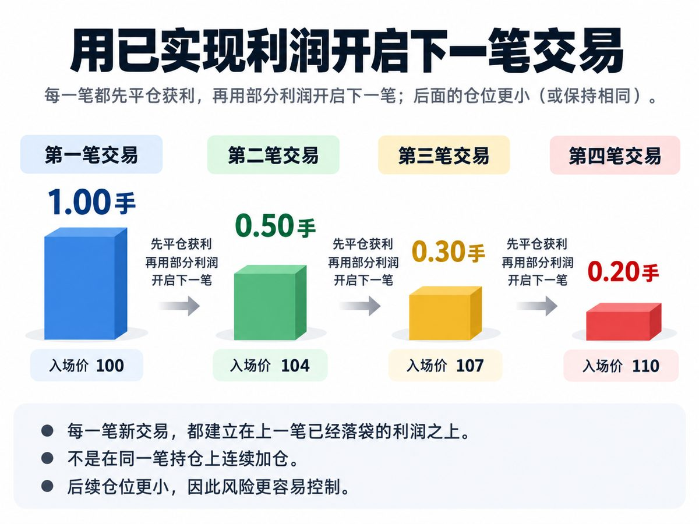

# 仓位：补输盘、赚钱后缩仓、对冲基金心态

_原文部分逐字保存（只把作者名换成 [导师]、群友名换成 [群友]；链接保留）。每段的来源行号和 sha256 在 `<!-- verbatim … -->` 标记里，`manifest.json` + `test/psych.test.ts` 校验能逐字还原原文件。下面的「DK 整理」是 DK 写的，不是导师原话。_

## 原文（逐字）

<!-- verbatim psych-batch-1.txt L63-L65 sha256=96b62aa1aa1dfd77 -->
交易尽量不要补输盘。我个人最多补一次而且必须先等到确认信号。 
但是可以大胆补赢盘，只要你不贪心早点出来

<!-- /verbatim -->

<!-- verbatim psych-batch-1.txt L734-L747 sha256=9257bac9c74eb21b -->
大家好， 我最近意识到，我发的一些交易，对很多人来说可能很难管理，甚至看起来有点疯。 但问题是：我不可能提前告诉你，你在一笔交易里可能犯的每一个错误。 我发了一些赚钱的交易，大家看到以后很兴奋。然后下一笔我发什么，有些人就开始加大仓位，甚至翻倍跟。 但你们要明白： 我发出来的交易，是我自己会持续管理的交易。 它不一定买进去马上就赚钱。 于是问题就来了： 一旦走势没有立刻按照预期发展，有些人就开始慌、开始害怕，甚至开始生气。 所以有几件事情，我必须再强调一次： 

1. 我的交易不可能每一笔都赚钱。

 我会判断错，我会止损，我也会亏钱。 有时候我也会犯错。 如果你看到我开了一笔交易，连自己对这笔交易到底有多少信心都没有认真想过，就因为是我发的而擅自放大仓位，那么我的一个错误，到了你那里就会被成倍放大。 我错一笔，可能只是正常止损。 你重仓跟进去，可能就是一次巨大的亏损。 所以不要把我的信心当成你的信心，更不要把我发的交易当成你加大仓位的理由。 任何告诉你自己每一笔交易都能赢的人，都是在吹牛逼。 

2. 我不会一上来就开一个巨大无比的仓位。

 仓位本身就是风险管理的一部分。 我可以承担波动，是因为我的仓位允许我承担波动，而不是因为我知道股票下一分钟一定会往哪里走。 

3. 股市不会影响我的情绪。

 一笔交易跌了，我不会害怕。 一笔交易涨了，我也不会兴奋到失去理智。 我只会看：逻辑还在不在？风险有没有变化？仓位需不需要调整？什么时候应该退出？ 所以请记住最重要的一句话： 如果一笔交易的涨跌已经开始明显影响你的情绪，那你的仓位就是太大了。 如果你盯着账户睡不着觉，太大。 如果跌一点你就开始慌，太大。 如果亏损以后你开始生气，想加仓把钱赢回来，还是太大。 仓位应该小到让你能够冷静地做决定。 交易不是比谁胆子大。 首先学会活下来，然后才是赚钱。

<!-- /verbatim -->

<!-- verbatim psych-batch-1.txt L859-L863 sha256=6e24a3969b6dcf2f -->
如果你开始情绪不稳定了，你就缩小仓位。缩到你能呼呼睡大觉，开始学基本功。 

别着急赚钱。先把基本功学好。

<!-- /verbatim -->

<!-- verbatim psych-batch-1.txt L975-L1003 sha256=ad4c729d8310c1a2 -->
骄兵必败

交易里最危险的时候，很多时候不是你连续亏钱的时候，而是你连续赚钱的时候。

连续几次判断正确之后，人很容易产生一种错觉：我已经摸透这个市场了。

然后仓位开始越来越大。
以前敢下 5%，后来下 10%，再后来觉得自己“高胜率”，直接上 30%、50%。

这就是骄兵必败。

市场不会因为你过去十次都对，就让你第十一次也对。你的判断能力可能没有变，变的是你对风险的敬畏。

真正成熟的交易者，连续赢钱以后不会问：

“我这么准，为什么不多下？”

而是会问：

“如果下一单我错了，这个仓位会不会把前面赚的钱全部吐回去？”

仓位大小应该由风险和确定性决定，而不是由你的自信决定。

记住：

赚钱可以让你的账户变大，但不要让你的胆子变大。

骄兵必败。市场最喜欢教育的，就是刚开始觉得自己不会错的人。

<!-- /verbatim -->

<!-- verbatim psych-batch-1.txt L1051-L1077 sha256=5ceb723358e79444 -->
很多人一赚钱，就开始不断放大仓位。

这不是一件好事。

上周我已经明确提醒过，这种情况很可能会发生。我甚至专门告诉很多人：赚了以后，停一天，休息一下。

因为连续盈利最危险的地方，不是你赚了多少钱，而是它会让你产生一种错觉——觉得自己突然变得更厉害了，觉得下一笔也一定会赢，于是开始加大仓位、提高风险。

很多账户不是在连续亏损的时候爆掉的。

而是在连续盈利之后，信心膨胀、仓位失控的时候爆掉的。

请你们理解：股市没有捷径。 自以为是、懒惰、冲动的人，在股市里迟早会付出非常昂贵的代价。 可以跟单的博主很多。 但这个平台真正宝贵的，从来不是我今天买了什么、卖了什么，而是这里的信息、策略和经验。 我一直在给你们提供市场分析、UA、宏观逻辑、风险管理、交易策略和交易心法。这些东西远比几个单子重要。 走到财务自由，可能需要十年。 走到我现在的位置，可能需要二十年。 所以，在你下一次下单之前，我希望你把下面几点真正记住： 

1. 你必须读，也必须理解我提供的宏观数据和市场观察。我是一个 Macro Trader（宏观交易者）。

你现在听的是一个宏观交易者讲交易，所以宏观自然就是整个交易体系的重要组成部分。 如果你只抄我的单，却不看我为什么看美元、原油、利率、债券、市场宽度、政策和资金流，那你学到的只是招式，没有学到心法。 市场环境一变，你就不知道该怎么办。 

2. 连续赚钱以后，你不能放大仓位。你反而应该缩小

 这一点我已经亲自示范给你们看过很多次。 随着市场风险增加，我的方向仓越来越小，而对冲越来越大。 因为赚钱以后最大的危险，不是市场，是你开始觉得自己不会错。 如果你一直用利润去承担风险、保持小仓位，同时提前做好对冲，那么行情逆着你走的时候，你仍然可以坐得住、想得清楚、慢慢处理。 如果你每赚一次就加码，最后只需要一次错误，就可以把前面很多次正确全部抹掉。 

3. 你不能产生隧道视野，只盯着赚钱的单子

 一个交易系统不是： “[导师]发了一个单，我买了。” 一个交易系统包括我在前后几天反复告诉你的： 风险在哪里、什么情况会使 thesis 失效、什么时候应该减仓、什么时候应该对冲、哪些数据需要观察、哪些行情不应该追，以及什么时候应该什么都不做。 如果你只看到了“买什么”，却忽略了我发出的多个警告、风险提示和应对方案，那你不是在执行我的交易系统。你只是在挑自己最想听的部分。 而市场最容易杀掉的，就是这种选择性阅读。 不要只学我怎么赚钱。 你更需要学的是： 我怎么控制仓位，怎么承认错误，怎么保护本金，怎么在判断错误以后仍然活着等下一次机会。

<!-- /verbatim -->

<!-- verbatim psych-batch-2.txt L123-L134 sha256=32571aa72f5ac4d8 -->
我跟大家交易的理念稍微不同一点

我把自己的帐号当成某种Hedge Fund，部署资源。我不把它当成钱。

所以，我买卖一般接近 “等，稳，看” 不太是 “着急出入获利”。 

我建议，大仓小仓都慢慢进入这种心态。 你会少很多焦虑，拉长时间线。

财富是90%的管理， 10%的赚。 

"买完了不管"的钱，这种大回调时两天就没了。

<!-- /verbatim -->

<!-- verbatim psych-batch-2.txt L143-L150 sha256=ce0ad8addfab15e3 -->
股市是一把枪。

用对的人可以财务自由。用错的人会被洗劫一空。

你的仓位就是枪的维护。不上油会生锈，不维护会卡壳，用错子弹会炸膛。

枪不能上了子弹放在那里不管。你的账号也是一样的。

<!-- /verbatim -->

## DK 整理（不是导师原话）

- **补输盘最多一次，而且必须先确认**（L63 起）。Alpha：同标的同结构已有亏损持仓时再开一笔 → `warn_add_to_loser_unconfirmed`（没写 `--confirm "确认信号"`）；第二次补 → `warn_second_add_to_loser`。已有 [纪律 #10 加仓计划](../discipline/discipline-01-20.md)（`discipline.ts` addPlanCheck）。
- **赚钱以后缩小仓位 / 骄兵必败**（L975、L1051 起）：连赢 ≥3 笔或上一交易日赚 ≥1% 本金后，最大亏损高于最近 5 笔平均 → `warn_size_up_after_wins`；上一交易日大赚 → `warn_day_after_big_win`（“赚了以后停一天”）。已有 `discipline.ts` euphoriaGate / sizeDisciplineCheck（同日、正式单）——这里是练习单的提示版。阈值未检验。
- **用已实现利润开下一笔，仓位递减**（下图，1.00 → 0.50 → 0.30 → 0.20；每笔是独立的新交易，不是往同一仓位加）= catalog `psych-realized-profit-redeployment`（之前缺图，现在有了）。Alpha：跟着盈利单开的下一笔最大亏损更大 → `warn_pyramid_add_larger`。
- **情绪不稳就缩仓，缩到睡得着**（L859 起）：数据里看不出焦虑 → 复盘卡手动问「这笔仓位让你焦虑/睡不着吗？是 → 下一笔缩小」。体力/心理资本 → [video-the-trading-game.md](video-the-trading-game.md)。
- 对冲基金心态、股市是一把枪（batch-2 L123、L143）→ catalog `size`、`psych-daily-loss-limit`。

_所有 Alpha 检查都只提示（warn / info），不阻止开仓；练习单唯一的硬要求仍是计划卡。默认值都未经检验，见 docs/DECISIONS.md 2026-10-17（交易心理）。_
